# Eversense in AndroidAPS 4

The Eversense E3/365 plugin receives glucose readings over Bluetooth. It provides transmitter status, calibration submission, a placement guide and optional uploads to Eversense DMS.

Project: [BernhardRo/AndroidAPS](https://github.com/BernhardRo/AndroidAPS/tree/master). For architecture and implementation details, see [TECHNICAL.md](TECHNICAL.md).

The screenshots below show AAPS 4.0.0 (`5d85b5094e`) in English with the dark theme on an Android emulator. No transmitter or DMS account was connected: `0%`, `Never`, `UNKNOWN` and empty signal bars are initial placeholders, not measurements from a transmitter.

## Setup

Complete sensor setup and alarm configuration in the official Eversense app first. Keep that app installed for functions not provided by AAPS.

1. Enable Bluetooth and select **Eversense** as the active blood glucose source in AAPS. Allow the requested Bluetooth/Nearby devices permissions.
2. Open the Eversense settings and expand **Eversense DMS credentials**.
3. Enter your DMS username and password. Both fields are required for E3 and ES365, even with cloud upload disabled.
4. Enable **European transmitter (365)** for a European/OUS DMS account; leave it off for a US account. The default is off.
5. Choose whether to enable cloud upload. It is on by default.
6. Open **Status & Connection**, press **Connect**, wait for the ten-second scan and select your transmitter. If one is already saved, Connect uses it.
7. Wait for connection setup, then check for a current glucose timestamp in the AAPS overview.

ES365 needs internet for initial registration. It can also need registration again after account or transmitter changes. Verify reception with your actual phone and transmitter before relying on the setup.

### Select the glucose source

Open **Configuration > BG Source**, select **Eversense** and confirm the switch. The highlighted card and selected radio button identify the active source. Tap **Open plugin**, then the settings icon in the top right to reach the Eversense settings.

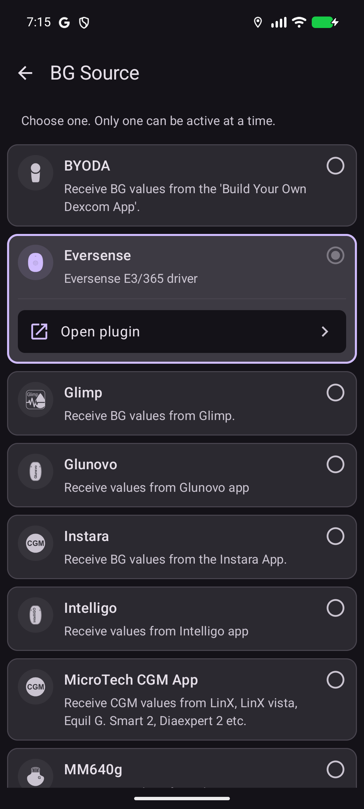

### Two ways to open the settings

From the overview, use either the **Settings** gear at the top right or the navigation menu at the top left. The screenshot also shows the optional **Eversense Calibration** shortcut in the QuickLaunch toolbar near the bottom, beside its configuration gear.

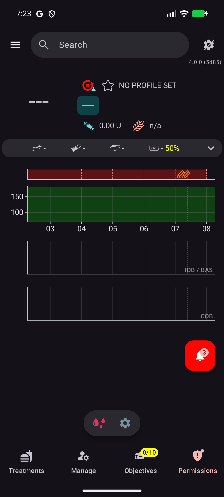

| Route | Steps |
| --- | --- |
| **Settings gear, top right** | Open Settings, then expand **Eversense**. Eversense must be the active BG source. If its section is hidden in Simple mode, turn off **General > Simple mode**, return to the overview and reopen Settings, or use the Configuration route below. |
| **Navigation menu, top left** | Choose **Configuration > BG Source > Eversense > Open plugin**, then tap the gear at the top right of the Eversense page. This opens the plugin's own settings. |

| Settings list reached from the overview gear | Left navigation menu |
| --- | --- |
| 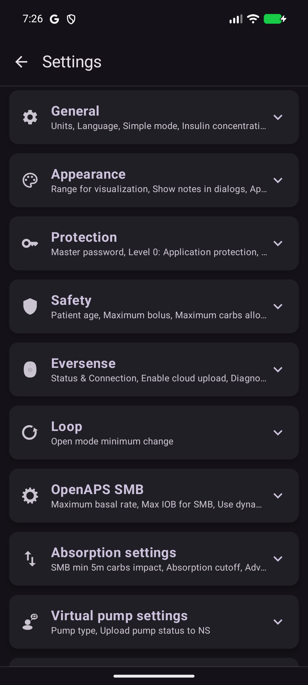 | 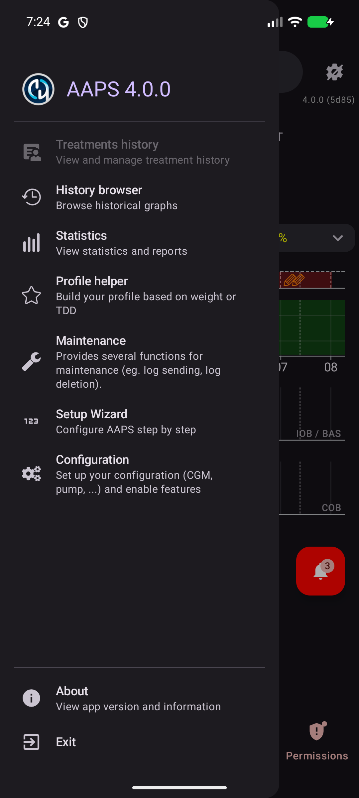 |

On the Eversense plugin page, use the gear in the top right (**Plugin preferences**). **No records available** in this example means that no transmitter readings have been received yet.

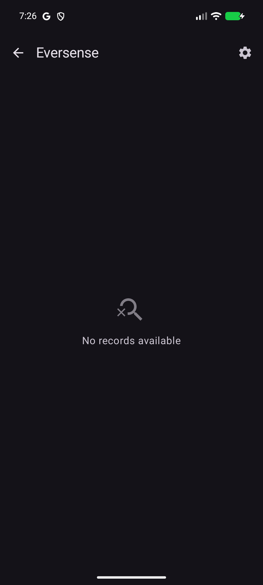

### Enter the DMS credentials

Expand **Eversense DMS credentials**. Tap **Username** and **Password** to enter your account details. **Not set** and **Password not set** mean that credentials are still missing. The **European transmitter (365)** switch selects the European servers; the screenshot shows its default off position. **Sign out** clears the saved credentials after confirmation.

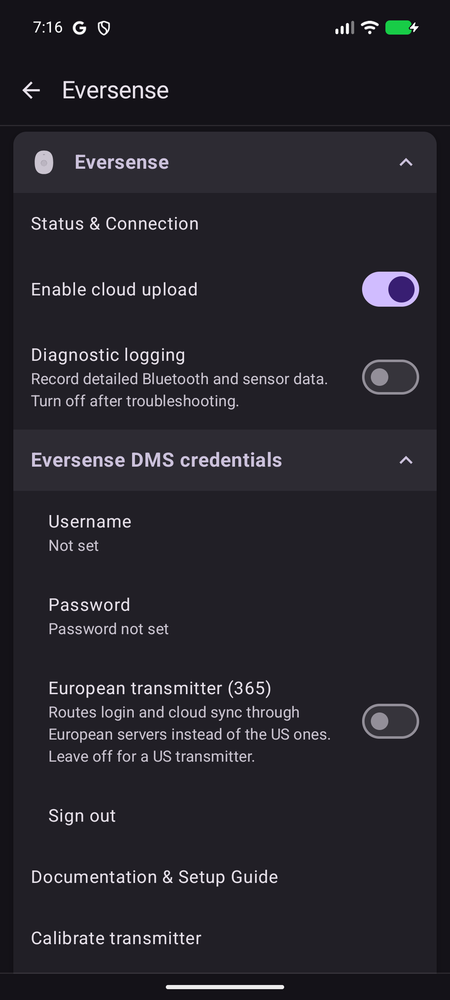

## Settings

The settings page groups connection controls, cloud upload, diagnostics, credentials and the two transmitter tools. Tap a row to open its page; the switches change cloud upload and diagnostic logging directly. **Documentation & Setup Guide** opens this guide.

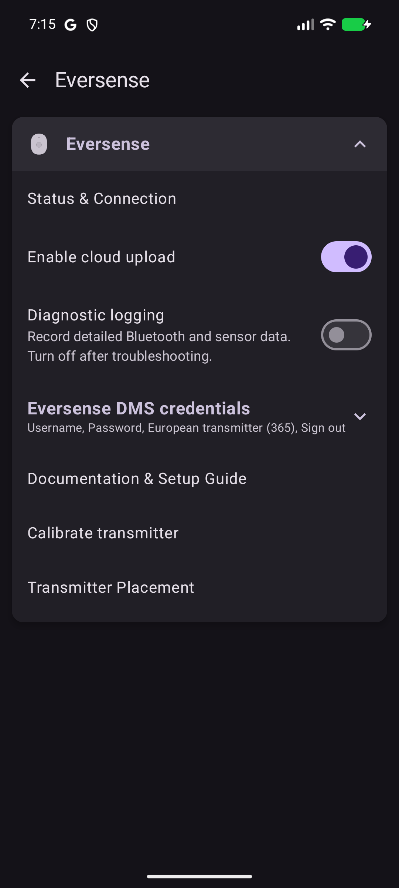

| Setting | Use |
| --- | --- |
| **Status & Connection** | View battery, sensor and calibration information; connect, disconnect, change transmitter or request a sync. |
| **Enable cloud upload** | Upload data to Eversense DMS at most once per hour. |
| **Diagnostic logging** | Collect extra detail for troubleshooting. Leave off during normal use. |
| **Eversense DMS credentials** | Edit username, password and region, or sign out. |
| **Calibrate transmitter** | Submit a calibration value. |
| **Transmitter Placement** | Check signal feedback while adjusting placement. |

**START SYNC** refreshes transmitter information; it does not force a DMS upload. **Default Sync Days** does not currently control how much glucose history is recovered.

## Daily use

### Connection and transmitter replacement

Unexpected connection loss triggers automatic retries. A manual **Disconnect** pauses them until you press **Connect** again.

To use a replacement transmitter, choose **Change Transmitter**, confirm and select it from the scan results. This does not delete glucose history in AAPS. Sensor linking still belongs in the official app.

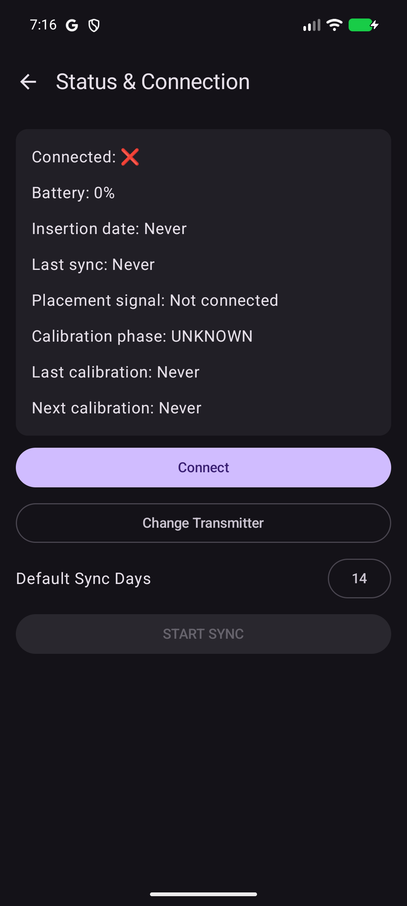

| UI element | Meaning |
| --- | --- |
| **Connected** | A check mark means the connection is ready after authentication. A Bluetooth link alone is not enough. |
| **Battery**, **Insertion date**, **Last sync** | Transmitter battery and stored sensor/sync timestamps. The initial values shown above have not been read from a transmitter. |
| **Placement signal** | Strength of the transmitter-to-sensor signal. |
| **Calibration phase**, **Last calibration**, **Next calibration** | Calibration state and timestamps reported by the driver. |
| **Connect / Disconnect** | Connect uses the saved transmitter, or opens a scan if none is saved. Once ready, the button becomes Disconnect. |
| **Change Transmitter** | Opens the replacement workflow instead of reconnecting to the saved device. |
| **Default Sync Days** | A selectable value; it does not currently determine recovered glucose history. |
| **START SYNC** | Refreshes transmitter information when connected. It is disabled in this disconnected screenshot. |

### Calibration

Calibration is available from the bottom QuickLaunch toolbar and from the plugin settings. Both send a fingerstick value to the Eversense transmitter, with different entry screens. Eversense must be the active BG source for its QuickLaunch action to be available.

#### From the bottom QuickLaunch toolbar

1. On the overview, tap the small **Configure QuickLaunch** gear near the bottom, just above the bottom navigation bar. It is separate from the Settings gear at the top right.
2. Under **Treatment**, tap **+** beside **Eversense Calibration**. The action moves into the selected actions list.
3. Return to the overview. Tap the new **Eversense Calibration** shortcut beside the QuickLaunch configuration gear, as shown in the [overview screenshot](#two-ways-to-open-the-settings).
4. Enter the fingerstick value in **BG**, check the unit and adjust with **− / +** if needed. The bottom confirmation button shows the entered value once it is valid. Tap it once to submit. Use **Close** at the top left to leave without submitting.

| Add the shortcut | Calibration opened from QuickLaunch |
| --- | --- |
| 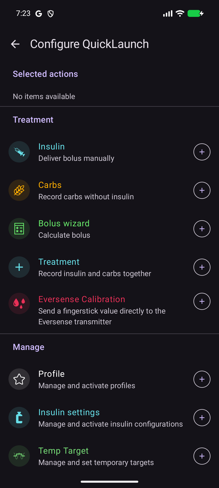 | 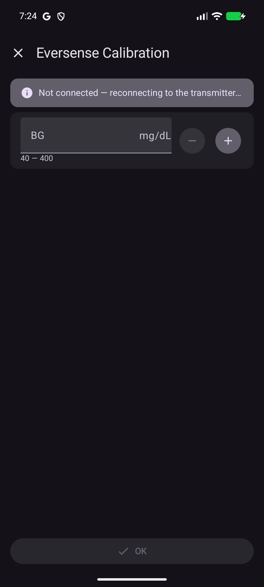 |

The example shows an empty value and a disconnected transmitter, so the confirmation button is disabled. If necessary, AAPS tries to reconnect when a calibration is submitted.

#### From the plugin settings

Open **Calibrate transmitter** in the [Eversense settings](#settings). Check the displayed unit, enter the blood glucose value and tap **Submit calibration** once. If necessary, AAPS first tries to reconnect.

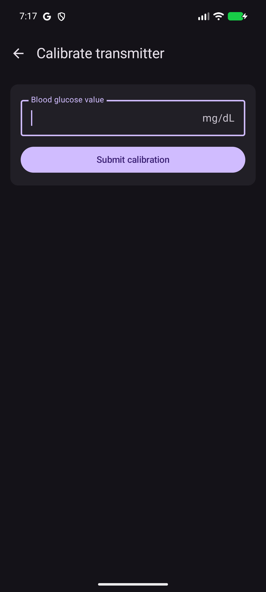

Tap **Blood glucose value** to enter the value. The focused field shows the unit on its right; this screenshot uses **mg/dL**. **Submit calibration** sends the entered value. The screenshot shows an empty field; no calibration was submitted for these illustrations.

A warning appears for current vertical or double up/down trend arrows, including stronger trends. A 45-degree arrow does not trigger it. The warning does not block submission. Follow the manufacturer's [calibration guidance](https://www.eversensecgm.com/siteassets/eversense-pwd-resources/eversense-365_fingcalibration_101124_v2-006.pdf); no warning does not prove that glucose is stable.

A successful submission starts a 15-minute countdown in the overview. This is not confirmation that the transmitter has finished processing. If submission fails, check connection and transmitter readiness before trying again.

### Placement

Open **Transmitter Placement**, adjust the transmitter using the signal feedback, then leave the page when finished. Placement signal describes the transmitter-to-sensor connection, not the phone's Bluetooth connection.

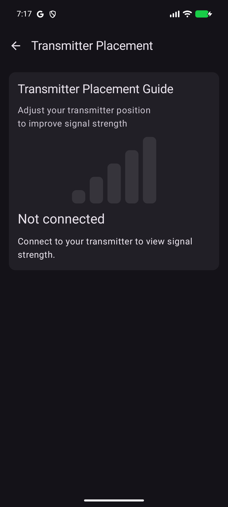

The five bars visualize placement signal strength. When readings are available, the page also shows a signal label, value and update time. Here, **Not connected** and inactive bars mean that no live placement signal is available; connect the transmitter before using the guide.

### Credentials and sign out

Account or region changes can interrupt reception and require ES365 registration again, so keep internet available.

**Sign out** is inside the expanded credentials group. After confirmation, it deletes the saved username/password and pending cloud uploads and pauses the connection. AAPS glucose history is retained. To resume, enter the credentials again and connect. Use Disconnect, rather than Sign out, for a temporary pause.

## Using the original Eversense app

**The original app can stay installed; uninstalling it is not required.** Keep it for sensor setup, transmitter settings and switching back to the manufacturer workflow.

- **E3:** parallel reception can work. Keep using both only if both receive current readings reliably.
- **ES365:** reliable parallel reception has not been established. Start with one active receiver.

If the apps compete, use Android **Settings > Apps > Eversense / Eversense 365 > Force stop** for the original app, then connect in AAPS. Swiping its window away may not stop its Bluetooth service. A force-stopped app does not provide its normal phone notifications until restarted.

To switch back, disconnect in AAPS first, then open the original app and check reception. Returning to AAPS may require ES365 online registration again. Do not clear app storage, remove Bluetooth pairing or relink the sensor simply to switch receivers.

## Offline use and cloud upload

After initial setup, readings can be received without internet, including in airplane mode with Bluetooth enabled. ES365 needs internet if registration is required again.

DMS upload is optional and does not affect local glucose reception. Uploads are attempted at most once per hour; readings are kept for up to seven days while waiting for connectivity.

## Troubleshooting and limits

| Problem | Check or limitation |
| --- | --- |
| No scan result | Bluetooth, Nearby devices permissions, range and transmitter state. Allow ten seconds for the scan. |
| Connect uses the old transmitter | Use Change Transmitter. |
| ES365 cannot finish registration | Internet, DMS credentials and European region. |
| No readings after Disconnect | Press Connect to resume automatic connection attempts. |
| Connected but no fresh glucose | Check the glucose timestamp, transmitter state, battery and placement. A status sync is not a new reading. |
| Gaps remain in history | E3 has no glucose backfill. ES365 recovery is limited, not a complete archive download. |
| Readings appear in AAPS but not DMS | Check upload, account/region and internet; allow for the hourly limit. Some recovered ES365 history cannot be uploaded. |

A settings export does not replace transmitter setup on a new phone. ES365 registration may be required again.

For a problem report, include the AAPS build, transmitter model, phone/Android version, problem time and whether the original app was running. Enable Diagnostic logging briefly to reproduce the issue, then turn it off. Review logs for private health/device data before sharing.
