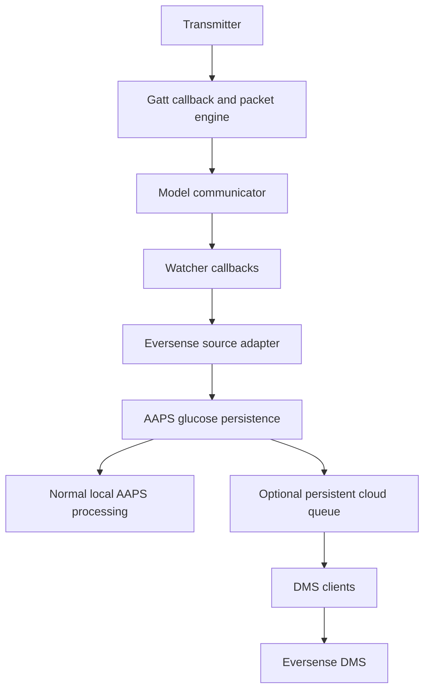
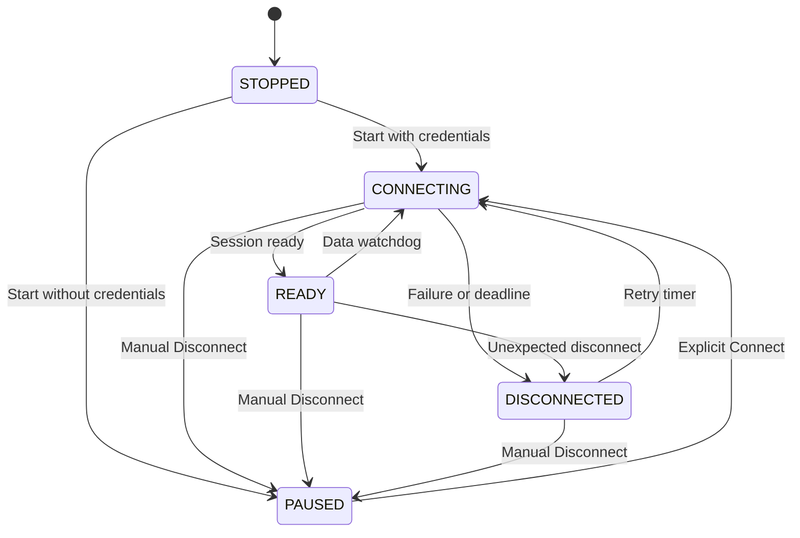
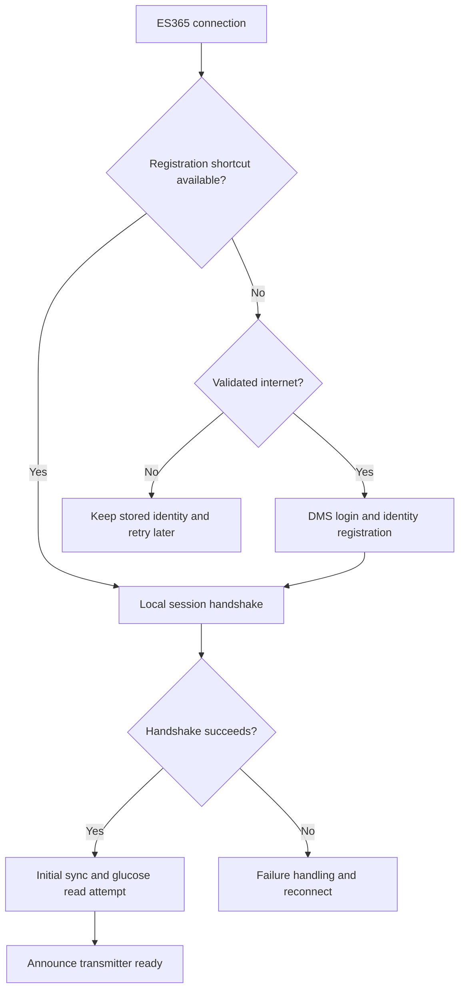
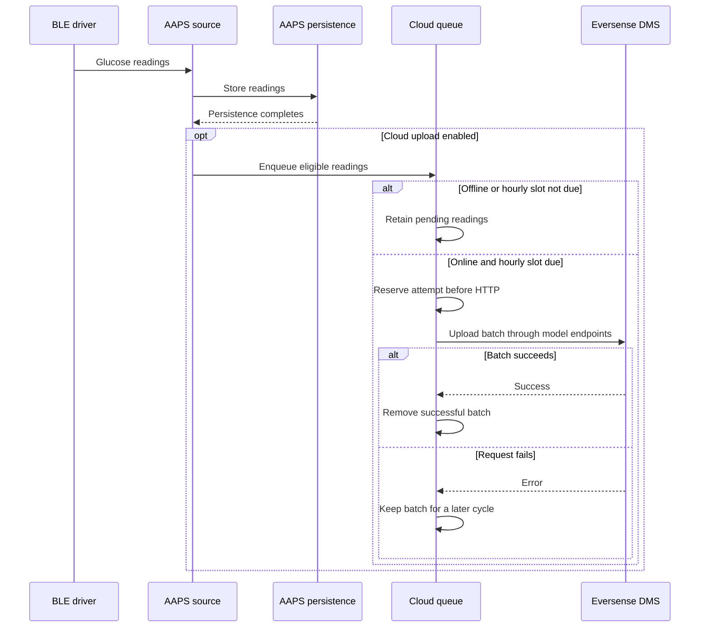

# Eversense plugin: architecture and behavior

This document describes the Eversense E3/365 implementation in this AAPS 4 checkout. It explains ownership, data flow, failure handling and current limits. It is not a claim of complete transmitter compatibility.

For setup and practical instructions, read the [user guide](README.md). Project: [BernhardRo/AndroidAPS, dev_es365](https://github.com/BernhardRo/AndroidAPS/tree/dev_es365).

## Module boundaries

| Area | Responsibility | Entry points |
| --- | --- | --- |
| This module | Android BLE, connection lifecycle, commands, codecs, authentication and DMS clients | EversenseCGMPlugin, EversenseGattCallback |
| [Source adapter](../source/src/androidMain/kotlin/app/aaps/plugins/source/EversensePlugin.kt) | AAPS source registration, preferences, persistence, cloud queue and notifications | EversensePlugin |
| [Source integration helpers](../source/src/androidMain/kotlin/app/aaps/plugins/source/eversense/) | Driver storage adapter, cloud delivery, placement lifecycle | EversenseStateStore, EversenseCloudUploader, PositioningSession |
| [Android activities](../source/src/androidMain/kotlin/app/aaps/plugins/source/activities/) | Status, calibration and placement screens | EversenseStatusActivity, EversenseCalibrationActivity, EversensePlacementActivity |
| [Shared calibration UI](../../ui/src/commonMain/kotlin/app/aaps/ui/compose/eversenseCalibrationDialog/) | Overview calibration form and view model | EversenseCalibrationDialogViewModel |
| core/interfaces | Shared calibration contract | EversenseCalibrationSource |
| core/keys and core/ui | Typed preference keys, password dialog and theme selection | StringPreferenceKey, SetPasswordDialog, UiMode |

The driver uses EversenseStore rather than directly reading AAPS preferences. The source module supplies the store adapter. Bluetooth and DMS delivery are Android-only; shared UI checks the active source's calibration contract.

Metro registers the source, driver and activity member injectors. The three device activities extend MetroAppCompatActivity. The application must provide their dependencies before layout inflation.

## Reading flow



Communicators decode readings and update driver state. The source maps readings to GV, preserving timestamp, glucose, trend and E3/365 source identity. It calls insertCgmSourceData before enqueueing optional cloud work. Upload failure cannot roll back a stored reading.

Watchers receive connection, readiness, state, glucose, alarm and placement events. A BLE link is not yet a ready transmitter: isConnected requires both a connected link and transmitterReady. ES365 attempts a glucose read after authentication instead of waiting for the next keep-alive.

## Connection control

EversenseConnectionController owns connection intent and timing. EversenseGattCallback owns the Android transport. The manager connects them through a small Transport interface.

| State | Meaning |
| --- | --- |
| STOPPED | Source stopped; no connection wanted. |
| PAUSED | Source running, but connection intent paused. |
| DISCONNECTED | Connection wanted; a retry can be pending. |
| CONNECTING | Opening or authenticating the connection. |
| READY | Session usable; data watchdog active. |

Source start requests automatic connection when credentials are present. Ordinary Connect calls do not start a second attempt while already connecting. The status page's explicit Connect uses the force path to restart an in-progress attempt. Manual Disconnect clears intent, invalidates work and cancels retries. Bluetooth becoming available only restarts work if the running source still wants a connection.

Unexpected failures back off through 5, 10, 20, 40 and 60 seconds. Failure to open a transport uses a 60-second retry. E3 status 19 waits 30 seconds. A normal ES365 status-19 reconnect can reuse the GATT handle.



Stop can move any running state to STOPPED and releases its resources. The diagram shows normal transitions; a forced Connect can also restart an existing attempt. PAUSED has no automatic retry.

### Stale callbacks and results

Each fresh GATT client gets a session token. Callback delivery and store access check ownership. Invalidation changes the token before closing the old client, so queued old work cannot publish new state.

Reused ES365 GATT handles also have a link generation. Authentication and network work capture this generation and use a restricted SessionStore. Results from a prior handshake cannot be accepted on a later link that reuses the callback.

Cloud work has a separate generation. Ordinary BLE reconnects do not cancel a valid upload. Explicit invalidation, such as stop, manual disconnect or account changes, ends that generation. SessionStore checks reads and final editor commits; stale access raises cancellation.

### Timing and cleanup

| Operation | Bound or behavior |
| --- | --- |
| Device scan | Ten-second deadline, with owner-specific cancellation handle |
| Connection/authentication | Three-minute attempt deadline |
| Data watchdog | Checked every minute; restarts after more than seven minutes without data |
| Ordinary packet response | Five-second default timeout |
| E3 calibration packet | Fifteen-second response timeout |
| Manager calibration operation | Twenty-second outer wait |
| UI calibration reconnect | Thirty-second wait |
| Full sync | Normally skipped if another completed within four minutes; force bypasses this |
| Placement | Initial 500 ms delay, then 500 ms between completed reads |

A write lock serializes packet exchanges. PacketExchange is registered before sending, so an early response cannot miss its waiter. Packet timeout closes the link before another command can consume a late response.

The callback has dedicated BLE and network executors. Registration HTTP runs on the network executor; the authentication sequence can wait for it without putting HTTP inside the Android BLE callbacks. Closing a callback releases GATT and executor resources. Source stop cancels its scope, removes watchers, stops scanning and closes the driver.

## Discovery, identity and authentication

The status UI presents scan results with names beginning with T followed by digits and removes duplicate names. The chosen Bluetooth address is saved. Service/characteristic discovery selects E3 or SecureV2; the credentials screen title does not select the model.

E3 has no ES365 online identity-registration exchange. The manager still requires non-empty username/password fields before opening either model's connection.

For ES365, EversenseCrypto365Util holds long-lived client identity material and a registration-shortcut flag. Without a usable shortcut, validated internet is required: the flow identifies the transmitter, logs in to DMS and obtains a certificate to register the identity. It then performs the local ephemeral/session handshake.

With an accepted saved identity, a new session can be established locally without refreshing the DMS upload token. Cloud tokens and BLE session keys serve different purposes. Upload-token expiry alone does not invalidate the BLE identity.



The offline path depends on a usable identity already being accepted by the transmitter. Failure handling can change which path the next attempt takes; the shortcut flag is not proof that a handshake will succeed.

Offline failures retain identity material for later attempts. Online authentication or decryption failures can invalidate the shortcut and trigger full registration. Stored identity is not guaranteed to remain accepted after transmitter changes or use by another client.

SecureV2Cipher owns stateless AES-CCM, sequence prefix and nonce construction. EversenseCrypto365Util retains identity, ephemeral material and sequence-counter ownership. Signing, ECDH, HKDF and AES use the existing cryptographic libraries.

### Original Eversense app

The plugin neither requires uninstalling the original app nor coordinates its Bluetooth use. It does not stop the original app, share its active connection or import its authenticated session.

Parallel E3 use is a reported setup behavior, not an enforced invariant. Reliable ES365 concurrent reception has not been established. Switching clients can exercise shortcut invalidation and online registration. The user guide therefore distinguishes keeping the app installed from allowing it to compete as an active receiver.

## Packet and binary layers

EversenseBasePacket takes an immutable PacketSpec with request ID, response ID, type ID and security mode. Metadata is explicit rather than discovered through runtime annotations. Public command names and nested response models remain available to callers.

The 109 command classes are grouped into eight files: E3 session, register queries, history queries, settings and calibration; ES365 session, data queries and settings. E3RegisterPacket shares register-address request encoding.

| Component in protocol/ | Responsibility |
| --- | --- |
| PacketSpec | Explicit command contract and response offset |
| WireEncoding | E3 command/payload/CRC16 frames and SecureV2 MTU framing |
| BinaryFields | Little-endian fields, packed dates/times, timezone offsets and sensor epoch |
| CalibrationPayload | Shared primitives with separate E3/ES365 layouts |
| GlucoseDecoders | Model offsets, validity bounds and trend mapping |
| NotificationAssembler | SecureV2 fragment order, duplicate suppression and assembly |
| SecureV2Cipher | Stateless authenticated encryption |
| PacketTime | System time in production; scoped clock input in tests |

The response buffer and notification assembler use growing byte streams instead of copying the full accumulated response at each append. The assembler ignores an identical fragment repeated inside one second. A new first fragment restarts partial assembly; an out-of-order fragment discards it. Reassembly does not own reconnect policy.

Some legacy rules remain intentionally unchanged: E3 accepts 20 through 450 mg/dL; ES365 rejects 450 and above and does not apply the same lower bound. Unknown live trends map to NONE; history mapping can use FLAT. Some malformed frames still throw. Compatibility tests preserve outcome categories, not general malformed-input hardening.

## Synchronization and history

E3 reads current glucose, status and calibration/log information. It does not backfill glucose history into AAPS.

ES365 reads current glucose and attempts calibration/history requests. RangeCalculator uses the prior glucose timestamp and caps a history request at 20 log indices. Returned history must lie between the previous and new live reading, with a 90-second margin at both ends. A history failure does not make recovery mandatory before publishing an otherwise usable current reading.

The status UI saves eversense_sync_days, default 14. Neither communicator uses it to calculate history requests. It is not a multi-day archive-download control. Recovered entries can lack sensor ID or raw data needed for full cloud representation.

A forced full sync bypasses the recent-sync check and requests transmitter data. It does not flush cloud work or bypass the hourly upload limit.

## Calibration and placement

The source implements EversenseCalibrationSource. If needed, it requests a connection and waits for readiness; cancellation removes the temporary watcher. The settings activity has a separate calibration form and reconnect path.

The shared calibration dialog limits input to 40–400 mg/dL or 2.2–22.2 mmol/L. The Android settings form checks a positive number and converts the displayed unit. These validation paths are not identical. Model-specific command adapters encode and send calibration values.

After successful send, the manager updates local calibration timestamps and provisional waiting state, then asynchronously re-reads E3 readiness. Callers request a forced sync and record EversenseLastCalibrationSubmittedAt. That timestamp drives the 15-minute overview countdown; it is presentation state, not proof of clinical readiness or an enforced interval.

EversenseCalibrationDynamics reads LastBgData and DateUtil. It warns only for fresh SINGLE, DOUBLE or TRIPLE up/down arrows. FORTY_FIVE_UP, FORTY_FIVE_DOWN, FLAT and NONE do not warn; a computed delta does not override that rule. Data older than Constants.OLD_BG_MINUTES or dated in the future is ignored. Missing data is not evidence of stability. The warning component is shared by both calibration entry points and uses the standard AAPS WarningBanner. It refreshes on resume and every five seconds while resumed, reading off the UI thread. Pause/disposal cancels that job; it does not poll Bluetooth or DMS. Warning state does not participate in canSubmit and does not block the driver call.

PositioningSession polls while the placement activity is resumed. Its mutex makes a new session wait for the old session's exit. Pause cancels polling, and a non-cancellable cleanup block attempts to leave transmitter diagnostic/placement mode. Diagnostic logging is a separate feature.

## Cloud delivery and offline behavior

EversenseCloudUploader owns an optional persistent queue, independent of BLE connection control. Enqueue follows successful local persistence.

- Batches group readings by transmitter type and serial number. Readings deduplicate by timestamp and sensor ID, preferring more raw data.
- ES365 entries without raw response data are excluded from the cloud queue, but can remain in AAPS.
- Retention is seven days with a total cap of 2016 readings; it does not prune AAPS history.
- A mutex protects updates and an atomic busy flag prevents concurrent flushes.
- Upload requires validated internet and the enabled setting. An attempt is reserved before HTTP, so failures also consume the hourly slot.
- The wall-clock attempt timestamp survives restart. A monotonic timestamp also prevents repeat attempts within an hour in the same process. A backward wall-clock jump resets the stored reference and defers that cycle.
- A later enqueue can trigger a due flush. There is no independent hourly wake-up timer.
- Successful batches are removed. Failure retains the batch and stops that cycle. Earlier successful requests can be repeated on retry; multiple endpoints are not one transaction.

ES365 delivery sends raw glucose, current portal values and device events. E3 sends current values and device events. One hourly cycle can make several requests. Upload failure does not request BLE reconnection.

DmsHttpClient shares HTTP transport, form/JSON content types, headers, UTF-8 handling and connection cleanup. DmsAccessTokens refreshes cached tokens with a five-minute expiry margin. Model clients retain their payloads and endpoint routing. E3 uses OUS endpoints; the region setting selects the ES365 US/EU group.

POST requests have 30-second connect/read timeouts. Certificate GET retains legacy zero/default transport timeouts. Registration has 65-second future waits and the outer connection deadline; those bounds do not guarantee immediate interruption of every underlying HTTP call.

Local Bluetooth reception does not wait for upload. ES365 initial registration still needs internet with optional upload off. Connectivity checks require Android internet capability and validated connectivity.



The stored readings remain available to normal AAPS processing regardless of the optional cloud branch. A cloud cycle is not scheduled at an exact clock time and can contain multiple HTTP requests.

## Storage and account changes

| Data | Storage/export behavior |
| --- | --- |
| Username, password, region and upload preference | Registered AAPS settings; username/password are exportable |
| Device/secure state, saved address, token metadata | EversenseRuntimeKey.DeviceState, eversense_device_state_json; not exported |
| Pending batches | EversenseRuntimeKey.CloudQueue, eversense_cloud_queue_json; not exported |
| Diagnostic switch | Registered, off by default, not exported |
| Glucose history | AAPS persistence, separate from driver state and queue |

EversenseStateStore imports legacy EversenseCGMManager SharedPreferences once if no registered device-state value exists. The old file remains. New writes use typed AAPS storage. The separate queue value avoids copying all queued readings on normal state updates. Settings import does not rewind live driver state.

The password is hidden in the UI but retrievable for login, not one-way hashed. The implementation does not establish that all account/identity storage is encrypted. Treat device storage, exports and logs as potentially sensitive.

Account/region changes invalidate current work, update state, disable the registration shortcut and clear tokens and queued uploads before reconnecting. Sign out also clears typed username/password and pauses connection intent. It does not wipe every identity field or delete AAPS history. Change Transmitter removes the saved Bluetooth address. These operations have different effects.

## Settings, theme and logging

DMS username, password, region and Sign out share one collapsible group. Sign out supplies an IntentPreferenceKey confirmation message. The normal renderer executes the clearing callback only after confirmation.

StringPreferenceKey.requiresPasswordConfirmation defaults to true. Only the Eversense password opts out. SetPasswordDialog then shows one masked field with a Done action and passes the entered value to both existing callback arguments. Other password/PIN preferences retain confirmation and their storage rules.

The three device activities use Compose with the central AapsTheme, LocalPreferences and AapsTopAppBar, as the other settings pages do. MaterialTheme supplies backgrounds, text, cards, buttons, menus and connection/scan dialogs. There is no private Eversense light/dark palette or XML theme selector. Theme changes update while a page is open, and standard Scaffold/app-bar insets protect navigation from system bars. The placement guide uses the same theme colors for active and inactive bars.

The source observes the diagnostic switch and resets active diagnostic logging on stop. Detailed messages use lazy formatting where supported. Dumps, state detail and stack traces are gated; normal action/status/error logs can still contain health/device information. Symmetric session keys are not logged. Disabling logging does not erase existing logs.

## Automated tests

From the repository root, use the supported JDK and ./gradlew.bat on Windows or ./gradlew on other hosts:

```text
./gradlew.bat :plugins:eversense:testAndroidHostTest
./gradlew.bat :plugins:source:testAndroidHostTest --tests "*Eversense*Test" --tests "*PositioningSessionTest"
./gradlew.bat :core:ui:testAndroidHostTest --tests "*SetPasswordDialogTest"
./gradlew.bat :ui:testAndroidHostTest --tests "*EversenseCalibration*Test"
./gradlew.bat :app:testFullDebugUnitTest --tests "*SourceGraphTest" --tests "*PreferenceKeySnapshotTest" --tests "*RawPreferenceStoreScanTest"
```

Coverage includes controller timing, pause/reuse, stale writes, early packet responses, queue retention and hourly limits, persistence during cloud failure, calibration, navigation, password entry and theme selection. Application graph tests cover integration. Run broader project checks when changing shared APIs and follow repository instructions before publishing.

### Frozen reference

src/androidHostTest/resources/protocol-reference.zip freezes the driver from commit bb0b0373cd6ccf6b935a63783cb5fcf29468e317. The archive and 156 source files have pinned SHA-256 checks. The command list records all 109 commands. Do not regenerate the reference from changed production code to make comparisons pass.

Gradle compiles reference sources only for host tests in an isolated package. Preparation changes package names, clock inputs, logger routing and endpoint mutability to supply equal inputs and local HTTP servers. Reference protocol algorithms stay unchanged. These classes are not APK production code.

Comparisons cover metadata, payloads, MTU frames, decoding and failure categories; dates, times and timezones; calibration and DMS binary records; notification traces; ciphertext, counters and tampering; and HTTP paths, headers, bodies, outcomes and caching. Independent CRC vectors and binary golden records supplement the reference. This protects exercised behavior, including legacy quirks; it is not formal proof of every device state.

## Real-device checks

Initial registration, reconnect, Bluetooth-off recovery, manual pause/resume, calibration results, placement cleanup and airplane mode with Bluetooth re-enabled still need device validation. Check local reception and DMS separately. Test original-app coexistence and measure battery use when relevant. Automated tests alone do not establish these outcomes.
