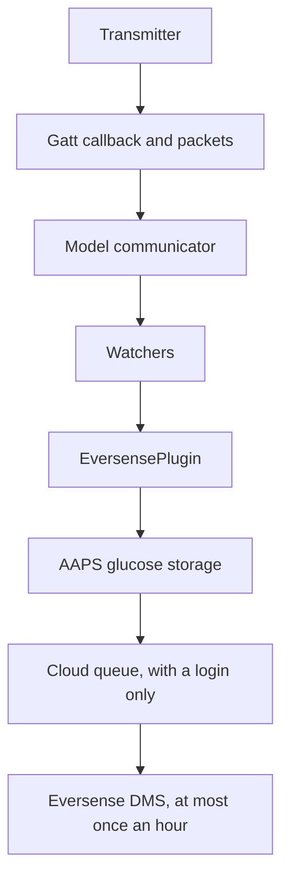
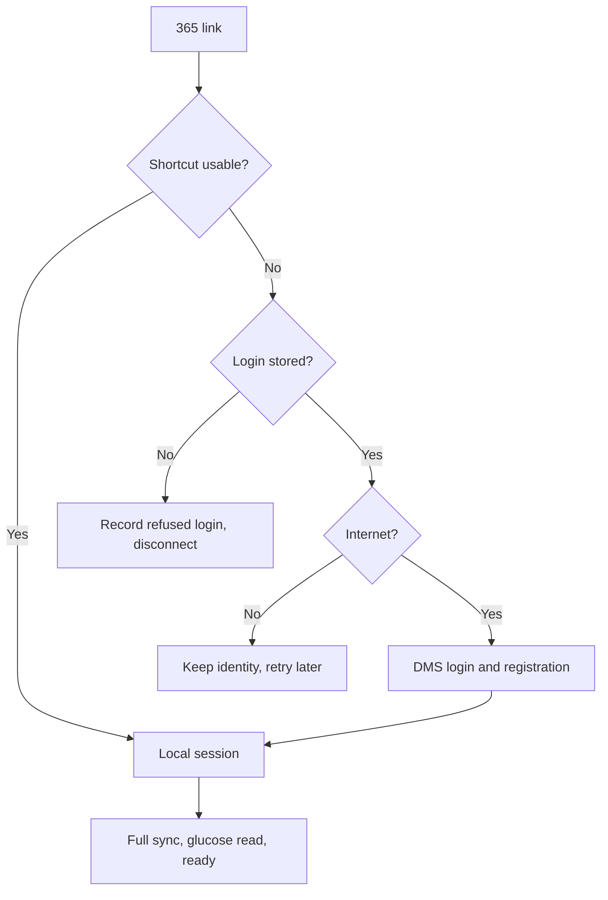

# Eversense plugin: architecture and behavior

How the Eversense E3 and 365 driver in this module works: who owns what, how data flows, what happens on a failure,
and what is not known yet. It is not a claim that every transmitter and firmware works.

The user guide is the AndroidAPS wiki. Setup is the pairing wizard on the plugin's screen.

## Module

Everything Eversense is in this module, as a pump driver has its own.

| Part | What it does | Entry points |
| --- | --- | --- |
| AAPS plugin (androidMain) | BG source, readings into AAPS, notices, cloud queue, calibration | `EversensePlugin` |
| Driver (androidMain) | Bluetooth link, connection control, packets, 365 authentication, Eversense cloud (DMS) clients | `EversenseCGMPlugin`, `EversenseGattCallback`, `EversenseConnectionController` |
| Pairing (commonMain) | The pairing wizard, the pairing card, what the user has to fix | `EversensePairing`, `EversensePairingViewModel`, `cgmAttention` |
| Screens (androidMain) | Status and calibration tabs, placement guide | `EversenseComposeContent`, `EversensePlacementActivity` |
| Shared AAPS code | Calibration routing and the CGM driver contract | `BgSource`, `CgmDriver`, `MasterRecordWriter` |

The driver reads and writes `EversenseStore`, not the AAPS preferences directly; `EversenseStateStore` maps it to one
stored JSON object. The pairing code is shared so that an iOS driver would only implement `EversensePairing`; on iOS
and desktop `NoEversenseDriver` stands in, and the plugin is Android only.

## Reading flow



The communicators decode readings and update the driver state. The plugin turns them into `GV` with time, value,
trend and `SourceSensor.EVERSENSE_E3` / `EVERSENSE_365`. A reading is stored before anything is queued for the cloud,
so a cloud failure never loses a reading.

Only a 365 sends the sensor insertion time with readings (it becomes a sensor change). The E3 value drifts, and each new
value would add a sensor change.

## Connection control

`EversenseConnectionController` owns whether a link is wanted and when to retry; `EversenseGattCallback` owns the
Android link. The plugin's start and stop are the only user-facing control: there are no Connect or Disconnect buttons.

| State | Meaning |
| --- | --- |
| STOPPED | Plugin stopped; no link wanted. |
| PAUSED | Plugin running, no link wanted (no login, no transmitter, or the login changes). |
| DISCONNECTED | Link wanted; a retry may be pending. |
| CONNECTING | Opening or authenticating. |
| READY | Usable; the data watchdog runs. |

A start connects when a transmitter is paired and the link may be opened (see below). Pairing in the wizard connects.
Retries back off through 5, 10, 20, 40 and 60 seconds; failing to open the link retries after 60 seconds; an E3
status 19 waits 30 seconds; a 365 status 19 may reuse the GATT handle. The reconnect uses `autoConnect = false` and
timers, which can run late while the phone sleeps (to check on a device).

Each GATT client gets a session token, and a reused 365 handle a link generation. Late callbacks and results of an
earlier link are dropped, and cloud work has its own generation, so a Bluetooth reconnect does not cancel an upload.

| Operation | Limit |
| --- | --- |
| Scan | 10 seconds |
| Connection and authentication | 3 minutes |
| Data watchdog | Checked every minute; reconnects after 7 minutes without a new reading |
| Packet answer | 5 seconds; a timeout closes the link, so a late answer cannot be taken for the next one |
| E3 calibration packet | 15 seconds |
| Calibration, reconnect first | 30 seconds |
| Full sync | Skipped if one finished in the last 4 minutes, unless forced |

## Pairing, login and authentication

The wizard asks for the model (E3, 365 USA, 365 other countries), checks the login with that model's server, scans
for transmitters (names `T` and digits) and connects. The login is stored by the driver: it is not a setting and is not
exported, so a new phone pairs again. Unpair forgets the transmitter and keeps the login; sign out is only in the
wizard.

- **E3:** links over Bluetooth alone. "Continue without signing in" stores the model E3 with no login; the link opens,
  and the cloud upload is off (the pairing card says so and offers to sign in).
- **365:** registers this phone with the Eversense server on its first link, so it needs the login and internet then.
  A 365 found without a login records a refused login, which shows the "!" badge and asks for one.

For a 365, `EversenseCrypto365Util` keeps the client identity and a shortcut flag. With the shortcut, a new session is
made locally, also offline. Without it, the driver logs in, gets a certificate and registers the identity, then makes
the local session. Shortcut failures while offline do not count against the identity.



The official Eversense app is not stopped or coordinated with. Two apps holding the same transmitter is not supported.

## Packets

`EversenseBasePacket` takes a `PacketSpec` (request id, response id, type id, security). The 44 commands the driver
sends are in six files: E3 session, register, history and calibration commands; 365 session commands and data queries.

| In `protocol/` | Role |
| --- | --- |
| `PacketSpec` | Command contract and answer offset |
| `WireEncoding` | E3 frames with CRC16, SecureV2 MTU framing |
| `BinaryFields` | Little-endian fields, packed dates and times, sensor epoch |
| `CalibrationPayload` | E3 and 365 calibration layouts |
| `GlucoseDecoders` | Offsets, validity limits, trend map |
| `NotificationAssembler` | SecureV2 fragment order and duplicates |
| `SecureV2Cipher` | Stateless AES-CCM |
| `PacketTime` | System time, a fixed clock in tests |

Glucose limits: E3 takes 20 to 450 mg/dL; a 365 reading and a 365 history entry 20 to 449. A 365 reading whose
"glucose unavailable" reason (byte 24 after the sensor id) is not 0 is not taken; that field's place comes from the
frame layout and still has to be confirmed on a transmitter.

The transmitter's alarm settings are neither read nor written: nothing in AAPS showed or changed them.

## Synchronization

E3 reads the current glucose, battery, calibration phase and readiness, dates and versions. It does not backfill
missed readings.

A 365 reads the current glucose, then up to 20 history entries since the last reading (`RangeCalculator`, 90 seconds of
margin at both ends), calibration information and active alarms. A failed full sync disconnects, so the next link
starts clean.

A 365 sets its Bluetooth disconnect timeout to 300 seconds ("this firmware rejects zero", from an EU transmitter).
Another implementation sets 0 on US firmware; which one is right is open.

## Calibration

The user calibrates in the AAPS calibration dialog; an SMS `CAL` and a client go through the master the same way.
The master hands the value to `EversensePlugin.calibrate` (calibration mode `SOURCE`).

- Refused before the confirmation: no transmitter paired, or an E3 that is not ready (glucose changing too fast, too
  soon after the last one, not enough data, sensor or transmitter problem). Not known yet is left to the transmitter.
  A 365 always reads as ready.
- The transmitter takes 40 to 400 mg/dL; the value is rounded, not truncated.
- Not connected: reconnects first and waits up to 30 seconds.
- After a calibration the overview shows a 15-minute countdown (`EversenseCalibrationBanner`). It shows that a
  calibration was sent; it is not a clinical rule.

The calibration time sent is the time of sending, not of the finger stick; an SMS confirmation can make that some
minutes later.

## Notices and alarms

| Notice | Id | When |
| --- | --- | --- |
| Transmitter alarm | `EVERSENSE_ALARM` | Pushed or active alarm; critical ones ring (`AlarmSound.ALARM`), since the vendor app is not there to |
| Battery low | `EVERSENSE_BATTERY_LOW` | 10 % or less, once per discharge; armed again above 20 % |
| Sensor expiry | `EVERSENSE_SENSOR_EXPIRY` | 60, 30 and the last 10 days, after noon |
| Calibration due | `EVERSENSE_CALIBRATION_DUE` | Once per calibration day |
| Transmitter not placed | `EVERSENSE_PLACEMENT` | Three readings without signal |
| New firmware | `EVERSENSE_FIRMWARE` | Once per version |

Each has its own card, so a reminder never replaces an open alarm. An unknown alarm code right after the placement
guide closes is dropped (a mode change, not a fault).

## Cloud upload

`EversenseCloudUploader` keeps a queue and sends at most once an hour, when a new reading comes and the phone is
online. It runs only with a login and the cloud setting on.

- Batches per transmitter type and serial; readings deduplicated by time and sensor id.
- 365 readings without raw data are not queued (they stay in AAPS).
- Kept 7 days, at most 2016 readings. An attempt is reserved before the HTTP call, so a failure also waits an hour.
- A 365 sends raw glucose, current values and device events; an E3 current values and device events.

The queue is one JSON text in the AAPS preferences (`eversense_cloud_queue_json`, not exported).

## Storage

| Data | Where | Exported |
| --- | --- | --- |
| Login, model, 365 identity, transmitter, tokens, state | `eversense_device_state_json` | No |
| Cloud queue | `eversense_cloud_queue_json` | No |
| Cloud upload on/off | AAPS setting | Yes |
| Glucose | AAPS database | As AAPS data |

`EversenseStateStore` imports the store of older builds (`EversenseCGMManager`) once. The password is stored so the
driver can log in again; it is not hashed.

## Logging

Everything logs through `AAPSLogger` with `LTag.BGSOURCE` into the AAPS log, so it is in the log export and is
switched with the other tags in the AAPS log settings. Packet details are debug lines. No session key and no decrypted
frame is logged; logs can still hold glucose and device data.

## Tests

```text
./gradlew.bat :plugins:source:eversense:testAndroidHostTest
./gradlew.bat :app:testFullDebugUnitTest --tests "*SourceGraphTest" --tests "*PreferenceKeySnapshotTest"
```

`src/androidHostTest/resources/protocol-reference.zip` freezes the driver of commit
`bb0b0373cd6ccf6b935a63783cb5fcf29468e317` (156 files with pinned hashes, 109 commands). Its sources are compiled into
the host tests only, in their own package, and `ProtocolCompatibilityTest` compares requests, frames and decoding with
the live code. 44 commands are compared; the 65 the driver never sent are listed in `protocol-commands-removed.txt`.
Decoding changed on purpose is listed in `ProtocolCompatibilityTest.decodingChangedOnPurpose` and tested in
`DecodingFixesTest`. Never regenerate the zip from changed code to make a comparison pass. The comparison proves "same
as before", not "right".

## To check on a device

- 365 Bluetooth disconnect timeout: 300 seconds or 0, per firmware and region.
- Reconnect after the transmitter was out of range, with the phone asleep.
- The 365 "glucose unavailable" reason field.
- The E3 calibration time zone: sent in UTC; another implementation's note says the iOS app uses local time.
- First registration, Bluetooth off and on, airplane mode, calibration results, placement guide, battery use.
