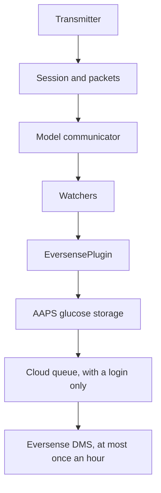
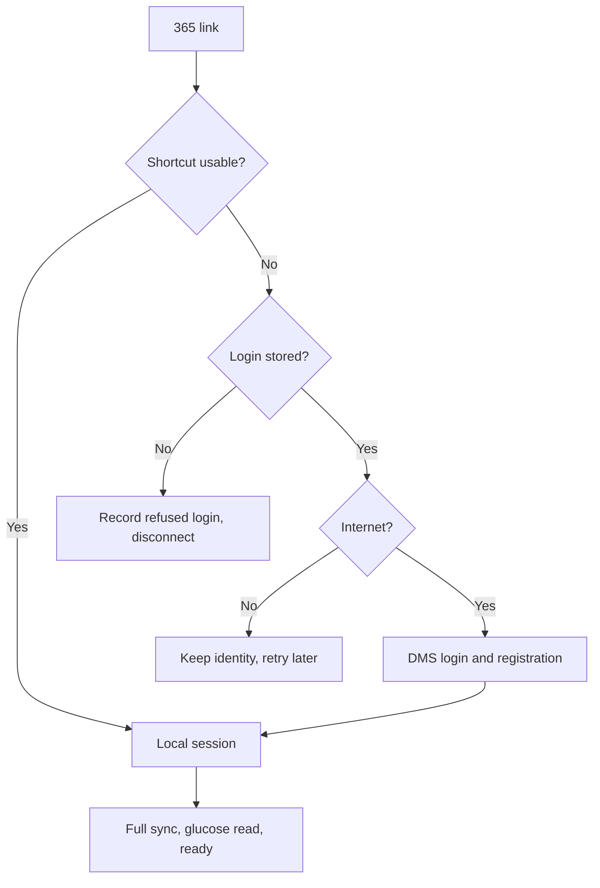

# Eversense plugin: architecture and behavior

How the Eversense E3 and 365 driver in this module works: who owns what, how data flows, what happens on a failure,
and what is not known yet. It is not a claim that every transmitter and firmware works.

The user guide is the AndroidAPS wiki. Setup is the pairing wizard on the plugin's screen.

## Module

Everything Eversense is in this module, as a pump driver has its own. All of it is in commonMain and runs on Android
and iOS; the platforms add only small parts.

| Part | What it does | Entry points |
| --- | --- | --- |
| AAPS plugin | BG source, readings into AAPS, notices, cloud queue, calibration | `EversensePlugin` |
| Driver | Connection control, one session per Bluetooth link, packets, 365 authentication | `EversenseDriver`, `EversenseSession` |
| Eversense cloud (DMS) | Sign-in, 365 registration, upload; ktor | `DmsHttpClient`, `EversenseHttp365Util`, `EversenseHttpE3Util` |
| Pairing | The pairing wizard, what the user has to fix | `EversensePairing`, `EversensePairingViewModel`, `cgmAttention` |
| Screens | Status and Glucose tabs; pairing wizard and placement guide inside the same screen. The status tab is the pumps' `PumpOverviewScreen`: a banner (not paired, login refused, or the link), label and value rows, the picture, and the buttons at the bottom (Pair, Sign in, Unpair among them) | `EversenseComposeContent`, `EversenseStatusViewModel`, `EversensePlacementScreen` |
| Shared AAPS code | Bluetooth, calibration routing and the CGM driver contract | `BleCentral`, `BgSource`, `CgmDriver`, `MasterRecordWriter` |

| Platform part | Android | iOS |
| --- | --- | --- |
| Bluetooth | `AndroidBleCentral` (in `:implementation`) | `IosBleCentral` (in `:implementation`) |
| HTTP engine (`dmsHttpEngine`) | OkHttp | Darwin (NSURLSession) |
| Crypto (cryptography-kotlin) | JCA | CryptoKit and CommonCrypto |
| Link closed by the transmitter (`closedByTransmitter`) | GATT status 19 | `CBError.peripheralDisconnected` (7) |
| Store of the first driver to import (`EversenseLegacyStore`) | SharedPreferences `EversenseCGMManager` | none |
| Registration | `EversenseAndroidRegistration` | `EversenseIosRegistration` |

Both registrations include `EversenseRegistration` (plugin, pairing, store, ViewModels). The desktop includes neither,
so it has no Eversense at all rather than one that cannot work.

The driver reads and writes `EversenseStore`, not the AAPS preferences directly; `EversenseStateStore` maps it to one
stored JSON object.

## Reading flow



The communicators decode readings and update the driver state. The plugin turns them into `GV` with time, value,
trend and `SourceSensor.EVERSENSE_E3` / `EVERSENSE_365`. A reading is stored before anything is queued for the cloud,
so a cloud failure never loses a reading.

Only a 365 sends the sensor insertion time with readings (it becomes a sensor change). The E3 value drifts, and each new
value would add a sensor change.

## Connection control

`EversenseDriver` owns whether a link is wanted and when to retry; an `EversenseSession` owns one `BleLink`. The
plugin's start and stop are the only user-facing control: there are no Connect or Disconnect buttons.

All driver state is changed on one thread (a dispatcher with parallelism 1), so it needs no locks. Work that sends
packets (sign-in, a sync, a calibration, a signal read) runs as a task of the session, one at a time.

| State | Meaning |
| --- | --- |
| STOPPED | Plugin stopped; no link wanted. |
| PAUSED | Plugin running, no link wanted (no login, no transmitter, or the login changes). |
| DISCONNECTED | Link wanted; a retry may be pending. |
| CONNECTING | Opening or authenticating. |
| READY | Usable; the data watchdog runs. |

A start connects when a transmitter is paired and the link may be opened (see below). Pairing in the wizard connects.
Retries back off through 5, 10, 20, 40 and 60 seconds; failing to open the link retries after 60 seconds. When the
transmitter closes the link itself: an E3 is tried again after 30 seconds (three in a row tell the user it is not over
the sensor); a 365 (its usual cycle) is waited for in the background (`autoConnect` on Android; iOS always waits so).
Other connects are direct, with timers, which can run late while the phone sleeps (to check on a device).

On iOS a suspended app runs no timers, so a link lost by radio (or gone silent) is connected again at once with a
connect that has no time limit: iOS keeps it open and wakes the app when the transmitter is back. A link the session
closed itself (no internet for a 365 registration, a failed sign-in) waits on the timers as on Android; at once it
would only fail again. A connect that waited for the transmitter gives the sign-in its full 3 minutes from the moment
the link is up (`reconnectWithoutTimers`).

Each link's work runs in the link's own coroutine scope, which ends with the link: nothing of an old link reaches the
next one, and a sync cut off by a lost link stores nothing. The cloud upload gets a guarded store
(`GuardedStore`) that closes when the driver stops or disconnects, so a sign-out cannot be undone by an upload in
flight.

| Operation | Limit |
| --- | --- |
| Scan | 10 seconds |
| Connection and authentication | 3 minutes |
| Data watchdog | Checked every minute; reconnects after 7 minutes without a new reading |
| Packet answer | 5 seconds; a timeout closes the link, so a late answer cannot be taken for the next one |
| E3 calibration packet | 15 seconds |
| Calibration, reconnect first | 30 seconds |
| Full sync | Skipped if one finished in the last 4 minutes, unless forced |

## Pairing, login and authentication

The wizard asks for the model (E3, 365 USA, 365 other countries), checks the login with that model's server, scans
for transmitters for 10 seconds and connects. The scan looks for the Eversense Bluetooth service, as Trio does, not
for a name: E3 names start with `T`, but a test transmitter showed `D313640`. A device with no name is left out. The
transmitter is found only in its pairing mode (its button pressed three times). A scan that found nothing says so, and why when
Bluetooth is off or not allowed, with "Scan again". The login is stored by the driver: it is not a setting and is not
exported, so a new phone pairs again. Unpair forgets the transmitter and keeps the login; sign out is only in the
wizard.

- **E3:** links over Bluetooth alone. "Continue without signing in" stores the model E3 with no login; the link opens,
  and the cloud upload is off (the account row of the status tab says so, and a "Sign in" button is offered).
- **365:** registers this phone with the Eversense server on its first link, so it needs the login and internet then.
  A 365 found without a login records a refused login, which shows the "!" badge and asks for one.

For a 365, `EversenseCrypto365Util` keeps the client identity and a shortcut flag. With the shortcut, a new session is
made locally, also offline. Without it, the driver logs in, gets a certificate and registers the identity, then makes
the local session. Shortcut failures while offline do not count against the identity.



The official Eversense app is not stopped or coordinated with. Two apps holding the same transmitter is not supported.

## Packets

`EversenseBasePacket` takes a `PacketSpec` (request id, response id, type id, security). The 44 commands the driver
sends are in six files: E3 session, register, history and calibration commands; 365 session commands and data queries.

| In `protocol/` | Role |
| --- | --- |
| `PacketSpec` | Command contract and answer offset |
| `WireEncoding` | E3 frames with CRC16, SecureV2 MTU framing |
| `BinaryFields` | Little-endian fields, packed dates and times, sensor epoch |
| `CalibrationPayload` | E3 and 365 calibration layouts |
| `GlucoseDecoders` | Offsets, validity limits, trend map |
| `NotificationAssembler` | SecureV2 fragment order and duplicates |
| `SecureV2Cipher` | Stateless AES-CCM, built from the AES block (no platform offers CCM on both) |
| `PacketTime` | System time, a fixed clock in tests |

Glucose limits: E3 takes 20 to 450 mg/dL; a 365 reading and a 365 history entry 20 to 449. A 365 reading whose
"glucose unavailable" reason (byte 24 after the sensor id) is not 0 is not taken; that field's place comes from the
frame layout and still has to be confirmed on a transmitter.

The transmitter's alarm settings are neither read nor written: nothing in AAPS showed or changed them.

## Synchronization

E3 reads the current glucose, battery, calibration phase and readiness, dates and versions. It does not backfill
missed readings.

A 365 reads the current glucose, then up to 20 history entries since the last reading (`RangeCalculator`, 90 seconds of
margin at both ends), calibration information and active alarms. A failed full sync disconnects, so the next link
starts clean.

A 365 sets its Bluetooth disconnect timeout to 300 seconds ("this firmware rejects zero", from an EU transmitter).
Another implementation sets 0 on US firmware; which one is right is open.

## Calibration

The user calibrates in the AAPS calibration dialog; an SMS `CAL` and a client go through the master the same way.
The master hands the value to `EversensePlugin.calibrate` (calibration mode `SOURCE`).

- Refused before the confirmation: no transmitter paired, or an E3 that is not ready (glucose changing too fast, too
  soon after the last one, not enough data, sensor or transmitter problem). Not known yet is left to the transmitter.
  A 365 always reads as ready.
- The dialog starts empty for a source that calibrates itself: the sensor's own reading is no finger stick.
- The transmitter takes 40 to 400 mg/dL (`calibrationRangeMgdl`): the dialog offers only these, and the master refuses
  an SMS or client value outside them before the confirmation. The value is rounded, not truncated.
- Not connected: the confirmation says so; the plugin reconnects first and waits up to 30 seconds.
- After a calibration the overview shows a 15-minute countdown (`EversenseCalibrationBanner`). It shows that a
  calibration was sent; it is not a clinical rule.

The calibration time sent is the time of sending, not of the finger stick; an SMS confirmation can make that some
minutes later.

## Notices and alarms

| Notice | Id | When |
| --- | --- | --- |
| Transmitter alarm | `EVERSENSE_ALARM` | Pushed or active alarm; critical ones ring (`AlarmSound.ALARM`), since the vendor app is not there to |
| Battery low | `EVERSENSE_BATTERY_LOW` | 10 % or less, once per discharge; armed again above 20 % |
| Sensor expiry | `EVERSENSE_SENSOR_EXPIRY` | 60, 30 and the last 10 days, after noon |
| Calibration due | `EVERSENSE_CALIBRATION_DUE` | Once per calibration day |
| Transmitter not placed | `EVERSENSE_PLACEMENT` | Three readings without signal |
| New firmware | `EVERSENSE_FIRMWARE` | Once per version |

Each has its own card, so a reminder never replaces an open alarm. Each transmitter alarm has its own card too: a
repeat replaces the card of the same alarm, and a second alarm does not remove or silence the first. Alarm names are
translated. An unknown alarm code right after the placement guide closes is dropped (a mode change, not a fault).

## Cloud upload

`EversenseCloudUploader` keeps a queue and sends at most once an hour, when a new reading comes and the phone is
online. It runs only with a login and the cloud setting on.

- Batches per transmitter type and serial; readings deduplicated by time and sensor id.
- 365 readings without raw data are not queued (they stay in AAPS).
- Kept 7 days, at most 2016 readings. An attempt is reserved before the HTTP call, so a failure also waits an hour.
- A 365 sends raw glucose, current values and device events; an E3 current values and device events.

The queue is one JSON text in the AAPS preferences (`eversense_cloud_queue_json`, not exported).

## Storage

| Data | Where | Exported |
| --- | --- | --- |
| Login, model, 365 identity, transmitter, tokens, state | `eversense_device_state_json` | No |
| Cloud queue | `eversense_cloud_queue_json` | No |
| Cloud upload on/off | AAPS setting | Yes |
| Glucose | AAPS database | As AAPS data |

`EversenseStateStore` imports the store of older builds (`EversenseCGMManager`) once. The password is stored so the
driver can log in again; it is not hashed.

## Logging

Everything logs through `AAPSLogger` with `LTag.BGSOURCE` into the AAPS log, so it is in the log export and is
switched with the other tags in the AAPS log settings. Packet details are debug lines. No session key and no decrypted
frame is logged; logs can still hold glucose and device data.

## Tests

```text
./gradlew.bat :plugins:source:eversense:testAndroidHostTest
./gradlew.bat :app:testFullDebugUnitTest --tests "*SourceGraphTest" --tests "*PreferenceKeySnapshotTest"
```

The host tests run on the JVM against the shared code; the session and the driver are tested with a fake
`BleLink` and `BleCentral`, the communicators with a fake `EversenseLink`.

The golden tests (`ProtocolGoldenTest`, `BinaryGoldenTest`, `SecureChannelGoldenTest`, `NotificationGoldenTest`) run
large input sets through the protocol code: every command's request, framing at several MTUs and decoding of many
answers; the packed dates, times and zone offsets; the cloud records; the 365 channel (AES-CCM, its counter, broken
material); the joining of notification chunks. Each group of outputs becomes one SHA-256 in
`src/androidHostTest/resources/golden/`. The digests were recorded on 2026-11-21 in a run where the first driver
(commit `bb0b0373cd`, compiled into the tests at that time) gave the same bytes, so they pin its behaviour; the frozen
sources are gone since. Three commands decode differently on purpose (lower limit, "glucose unavailable", protocol
version text): `DecodingFixesTest` explains them, and their digests pin today's decoding. A failing group writes its new
digest to `build/golden-actual/`; copy it over the recorded one only for a change made on purpose and checked on a real
transmitter. The digests prove "same as before", not "right".

## Emulator

`emulator/` holds an emulated transmitter for the shared emulated Bluetooth (`EmulatedBleCentral`), as the pump
emulators have: `EversenseTransmitterEmulator` (clock, readings, battery, calibrations), `EversenseE3Peripheral`
(CRC frames, register reads, keep-alive pushes) and `Eversense365Peripheral` (the sign-in, AES-CCM both ways,
fragmented notifications, the history log for a backfill, keep-alives and pushed alarms). Its frames use the driver's
own encoders, and the 365 side agrees its session key with its own ECDH and HKDF. Built from the driver's code, not
from captured frames: UNVERIFIED until real frames are recorded.

- Tests: `EmulatedE3Test` and `Emulated365Test` run the real driver against it in virtual time (sign-in, readings,
  keep-alive, backfill of a gap, clock, calibration, signal, alarm, Bluetooth off and on). `EmulatedRegistrationTest`
  runs a 365's first registration against a fake Eversense server on the machine (real time, a few seconds).
- In the app: the `emulate_eversense` option file gives Eversense an emulated E3 (`EversenseCentral`) instead of the
  phone's Bluetooth. Pair it in the wizard with "Continue without signing in". The cloud upload is off while it is
  emulated, so no emulated reading reaches a real Eversense account. A 365 is not offered in the app: its first
  registration needs the real Eversense server.

## To check on a device

- 365 Bluetooth disconnect timeout: 300 seconds or 0, per firmware and region.
- Reconnect after the transmitter was out of range, with the phone asleep.
- The 365 "glucose unavailable" reason field.
- The E3 calibration time zone: sent in UTC; another implementation's note says the iOS app uses local time.
- First registration, Bluetooth off and on, airplane mode, calibration results, placement guide, battery use.
- The rewrite onto the shared Bluetooth layer: the write type (Android chose "without response" when the request
  characteristic offers it; the session does the same), the MTU and the 365 reconnect in the background.
- iOS: all of the above, never run on a transmitter yet. iOS ends a link in the background unless the app is woken by
  Bluetooth; that needs state restoration in `IosBleCentral`, which is not there yet.
